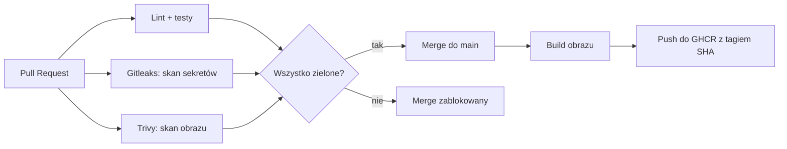

# DevSecOps Pipeline


Pipeline CI/CD z automatycznymi kontrolami bezpieczeństwa dla skonteneryzowanej aplikacji. Każda zmiana w kodzie jest automatycznie testowana i skanowana pod kątem sekretów i podatności, a po zmergowaniu do `main` budowany jest obraz Docker, który trafia do rejestru kontenerów.

Aplikacja jest celowo prosta, bo celem projektu jest **proces dostarczania i jego bezpieczeństwo**, a nie sam kod.

## Jak działa pipeline



### Na każdy Pull Request
| Job | Narzędzie | Co sprawdza |
|-----|-----------|-------------|
| `test` | flake8, pytest | styl kodu i poprawność działania |
| `secrets-scan` | Gitleaks | wyciek haseł i kluczy w kodzie **i w historii commitów** |
| `image-scan` | Trivy | znane podatności (HIGH/CRITICAL) w zależnościach i obrazie |

Wszystkie trzy joby są **wymaganymi checkami**: bez zielonego wyniku nie da się zmergować PR. Gałąź `main` jest chroniona, zmiany wchodzą wyłącznie przez Pull Request, a force-push jest zablokowany.

### Po merge do `main`
Obraz jest budowany i wysyłany do **GitHub Container Registry**, oznaczony hashem commita. Dzięki temu każdą wersję można jednoznacznie zidentyfikować i w razie potrzeby cofnąć. Nie używam tagu `latest`.

## Stack

- **Aplikacja:** Python, FastAPI
- **Testy i lint:** pytest, flake8
- **Konteneryzacja:** Docker (multi-stage build, użytkownik non-root)
- **CI/CD:** GitHub Actions
- **Bezpieczeństwo:** Gitleaks, Trivy
- **Rejestr obrazów:** GitHub Container Registry (GHCR)

## Decyzje projektowe

- **Multi-stage build:** obraz końcowy nie zawiera narzędzi potrzebnych tylko do budowania, więc jest mniejszy.
- **Użytkownik non-root:** proces w kontenerze nie działa jako root, co ogranicza skutki ewentualnego włamania.
- **Kolejność warstw w Dockerfile:** zależności są instalowane przed skopiowaniem kodu, więc cache działa przy zmianach samego kodu.
- **Przypięte wersje zależności i akcji:** powtarzalne buildy i wiarygodne skanowanie podatności.
- **Skan całej historii w Gitleaks (`fetch-depth: 0`):** sekret usunięty z pliku nadal może siedzieć w starym commicie.
- **Trivy z `ignore-unfixed`:** pipeline nie blokuje się na podatnościach, na które nie ma jeszcze poprawki.
- **Tag obrazu = hash commita:** jednoznaczna identyfikacja wersji i możliwość rollbacku.
- **Logowanie do GHCR wbudowanym `GITHUB_TOKEN`:** brak własnych sekretów w repozytorium.

## Przykład z praktyki

Przy pierwszym uruchomieniu Trivy wykrył **3 podatności w bibliotece Starlette** (zależność pośrednia FastAPI). Naprawiłem je przez aktualizację zależności w `requirements.txt` i jawne przypięcie wersji Starlette, po czym pipeline przeszedł na zielono. To dokładnie ten scenariusz, do którego pipeline został zaprojektowany.

## Uruchomienie lokalne

```bash
python3 -m venv venv
source venv/bin/activate
pip install -r requirements.txt
pytest
```

Serwer deweloperski:

```bash
uvicorn app.main:app --reload
```

Docker:

```bash
docker build -t devsecops-app .
docker run -d -p 8000:8000 --name app devsecops-app
curl http://localhost:8000/health
```

| Endpoint | Opis |
|----------|------|
| `GET /health` | Status aplikacji |
| `GET /version` | Wersja aplikacji |
| `GET /items` | Przykładowa lista elementów |

## Możliwe rozszerzenia

- Wdrożenie na AWS (EC2) przez Terraform z osobnymi środowiskami dev i prod
- Uwierzytelnianie GitHub Actions do AWS przez OIDC zamiast kluczy
- Ręczna akceptacja wdrożenia na produkcję (GitHub Environments)
- Skan kodu infrastruktury (Checkov)
- Automatyczne aktualizacje zależności (Dependabot)

## Czego się nauczyłem

- Projektowanie pipeline'u CI w GitHub Actions z równoległymi jobami
- Dlaczego skany bezpieczeństwa powinny być wymaganym warunkiem merge
- Analiza raportów Trivy i naprawa podatności w zależnościach
- Praca z chronioną gałęzią i Pull Requestami
- Publikowanie obrazów do rejestru i tagowanie wersji
